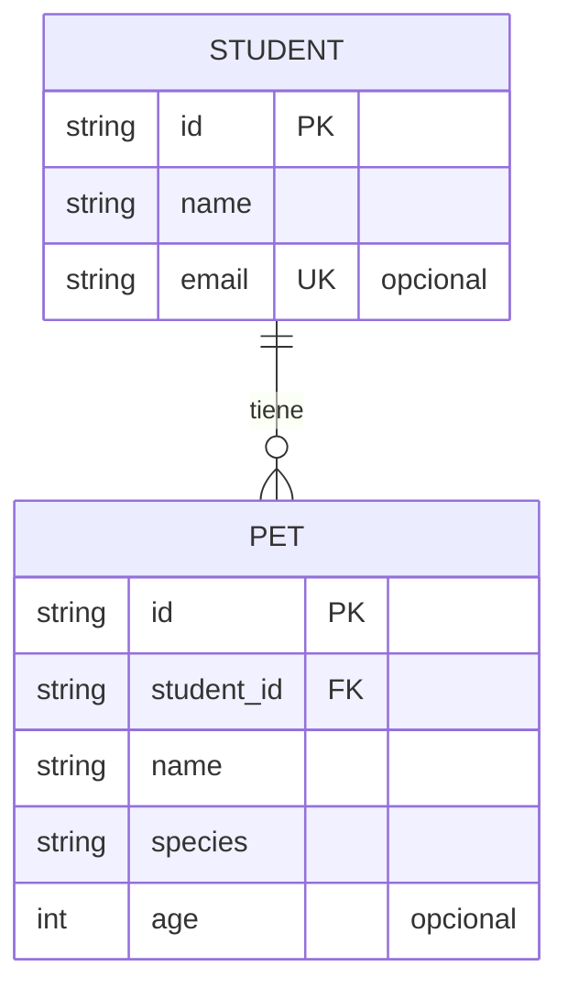

# Modelo actual de estudiantes y mascotas

Este diagrama refleja las tablas ORM que existen en este repositorio. El plan adjunto describe otro dominio (clientes, servicios, profesionales y citas), que no aparece en este código; no se presentan esas entidades como implementadas aquí.

`students.email` es único cuando se informa. `pets.student_id` referencia `students.id` con borrado en cascada y existe una restricción única por `(student_id, name)`.

## Alcance de la persistencia

`POST /api/students` guarda el estudiante y sus mascotas anidadas en una sola transacción SQLAlchemy. Si el guardado falla, se revierte la transacción. Las rutas independientes `/api/students/{studentId}/pets` todavía usan un repositorio en memoria; sus cambios no sobreviven al reinicio.
